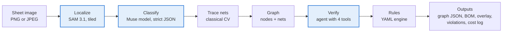
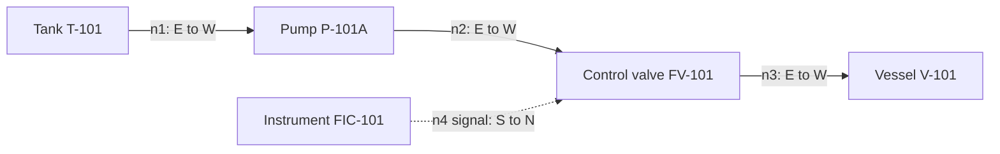
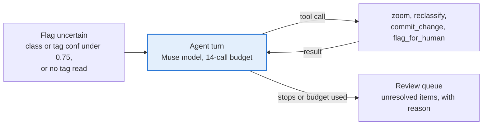

# P&ID Digitizer

**Scanned engineering drawing in → verified graph, bill of materials and design-rule violations out.**

Built for the Meta Global AI Developer Hackathon (Push the Frontier: manufacturing and energy).
**Built with Meta models:** SAM 3.1 finds the symbols, a Muse model reads them and verifies uncertain ones. Both are called through the Meta Model API.

Process plants hold decades of drawings as images. Their structure (which pump feeds which vessel, which valves isolate what)
is locked in pixels, which blocks plant modifications, safety reviews and digital twins. This project reads a P&ID and produces:

1. a machine-readable **graph** (symbols, tags, and the pipes / signal lines connecting them)
2. a **bill of materials** (CSV)
3. an **annotated overlay** of the original drawing
4. **design-rule violations**, each pointing at the exact place on the drawing; new rules can be written in plain English

> **Design principle: models propose, deterministic code decides.** SAM 3.1 and the Muse model produce candidate symbols, tags
> and links with confidences. A verification agent re-examines the uncertain ones with tools. The rule engine that raises violations
> is ordinary code over the graph, so every finding is reproducible, testable and auditable. A language model can *author* a rule,
> but it can never decide whether a rule is violated.

---

## Setup

Run every command in a terminal opened **inside the project folder**. The tests and the offline mode need no API key; the smoke
tests, the live evaluation and the live UI call Meta's models and do.

**1. Requirements:** Python 3.10 or newer (conda or venv), and a Meta Model API account at [dev.meta.ai](https://dev.meta.ai) with credits.

**2. Create an environment and install**
```bash
conda create -n pid python=3.12 -y     # or: python -m venv .venv  and activate it
conda activate pid
pip install -e ".[dev]"                # installs the project and its dependencies from pyproject.toml, plus pytest
pytest -q                              # every test should pass (no API key needed for this)
```

**3. Get an API key**
1. Sign in at [dev.meta.ai](https://dev.meta.ai) and click **API keys** in the left menu.
2. Click **Create API key**, name it (for example `pid-digitizer`) and copy it right away. It is shown only once.
3. Open **Billing** or **Usage** to confirm your credits are on the account.

**4. Create `.env`**
```bash
copy .env.example .env                 # Windows
cp .env.example .env                   # Mac / Linux
```
Open `.env` in a text editor and fill in these three lines (only the key changes):
```
LLM_API_KEY=paste-your-key-here
LLM_BASE_URL=https://api.meta.ai/v1
LLM_MODEL=muse-spark-1.3
```
- The program reads `.env` automatically from the folder you run commands in. You do not need to export variables.
- The file must be named exactly `.env` (not `.env.txt`; Windows can hide extensions). Check with `dir .env*`.
- Use the Standard model, not `muse-spark-1.3-contributor`: Contributor mode lets Meta train on your inputs.
- SAM 3.1 reuses the same key and base URL by default (`SAM_API_KEY` / `SAM_BASE_URL` override them).
- `.env` is git-ignored. Never commit or share the key.

**5. Check the connection**
```bash
python -m pid.smoke llm                       # Muse model: basic call, vision, strict JSON, tool calling, with cost
python -m pid.smoke localize                  # SAM 3.1: box recall on generated sheets, with cost
python -m pid.smoke localize --localizer muse # the alternative: the Muse model finds the boxes itself
python -m pid.smoke localize --localizer both # union of SAM and Muse boxes
```
Each check prints PASS or FAIL with the reason. A 401 means a wrong key or base URL; a 404 means a wrong model id.
`localize` prints recall (ground-truth symbols found) and precision (detections that are real symbols). If SAM finds few symbols,
`python -m pid.smoke sam-debug` tries a list of prompt phrases and shows which ones match the ground truth; set the best ones with
`SAM_PROMPTS=symbol,rectangle,circle` in `.env`.

**6. Run the web UI**

Open a terminal (a new one is fine while another command is running) and run:
```bash
cd <your project folder>
conda activate pid
python demo/make_demo_assets.py               # once: creates clean_sheet.png, planted_errors.png, noisy_scan.png, legend.png in demo/
streamlit run src/pid/app/ui.py               # starts the UI; it opens in your browser, usually at http://localhost:8501
```
In the UI:
1. In the sidebar, set **Mode** to **Live models**.
2. Choose a **Localizer**: `sam` (default), `muse`, or `both` (highest recall, a few more false boxes).
3. Upload `demo/planted_errors.png` (a full sheet with design errors planted on purpose) and click **Run analysis**.
4. Read the result in the tabs: Overlay, Violations, Graph / BOM, Agent log, Review queue, Performance.

`demo/legend.png` is only the symbol key (no pipes), so it shows symbols but zero nets. Use it to check classification, not whole-sheet results.
To stop the UI, press `Ctrl+C` in its terminal.

HTTP API instead of the UI: `uvicorn pid.app.api:app` (interactive docs at `http://localhost:8000/docs`).

**7. Measure**
```bash
python -m pid.eval.run_eval --mode live --n 6                      # SAM + Muse + agent
python -m pid.eval.run_eval --mode live --n 6 --no-agent           # ablation: without verification
python -m pid.eval.run_eval --mode live --n 6 --localizer muse     # ablation: Muse model finds the boxes (or: both)
python -m pid.eval.run_eval --mode live --split test               # held-out sheets (seeds >= 1000; do not tune on them)
```
Results are written to `eval/results/` and summarized in the table under *Evaluation protocol*.

**Without any key:** `python -m pid.eval.run_eval --mode simulated` and the UI's "Offline simulated" mode run the tracing and rules
with the model stages replaced by ground truth. They need no key, and their scores are not model accuracy.

## Architecture



Blue stages call a Meta model; the others are ordinary code. Only the rule engine decides violations.

**Example graph.** A net records which side of each symbol it touches, so flow direction and junctions are kept.



**Verification agent.** It can call only four whitelisted tools, every call is logged, and unresolved items go to a person.



**Why nets, not edges.** A tee feeding two valves is one net with three attachments, not a clique of edges. Flow direction comes from the
side a pipe meets a symbol (west = inlet, east = outlet), which is what lets rules say "downstream of the pump".

### Meta models and their jobs

Both are served by the Meta Model API. The localizer is pluggable (`PID_LOCALIZER=sam|muse`), so the two approaches can be compared on the same sheets.

| Model | Role |
|---|---|
| SAM 3.1 | localization: finds symbol bounding boxes from text prompts, tile by tile |
| Muse model (vision input) | symbol classification and tag reading from crops; legend parsing |
| Muse model (reasoning levels) | low for routine crops; medium/high for disputed items in the verification loop |
| Muse model (tool calling) | the verification agent |
| Muse model (structured output) | schema-constrained classification; natural-language → rule DSL |
| Muse model (vision, tiled), optional | alternative localizer for comparison (`--localizer muse`) |

## Rules

Rules are YAML. Example:

```yaml
- id: R4-PUMP-CHECK-VALVE
  severity: warning
  description: Pump discharge needs a check valve within 2 hops downstream
  applies_to: {class: pump}
  require:
    path: {direction: downstream, edge_type: process, max_hops: 2, reaches: {class: check_valve}}
```

Requirements: `path`, `unique: tag`, `has_attr: tag`, `connected: true`, and `min_symbols: N` (for `kind: net`). The starter pack
(`src/pid/rules/starter_pack.yaml`) is **illustrative**: real plants apply their own engineering standards, and passing these checks does
not establish safety compliance.

Natural-language rules ("every pump needs an isolation valve on both sides") are compiled by the Muse model into this DSL, **validated
against the schema** (unknown classes and malformed conditions are rejected and sent back for repair), previewed on reference sheets, and
applied only after you approve them.

## Evaluation protocol

- Sheets are generated by `pid.synth` (original symbols, so there are no data-rights issues) with planted errors; the expected violations
  are known by construction. Seeds < 1000 are development, ≥ 1000 are held-out test.
- Metrics: symbol localization/class F1 (IoU 0.5), tag read accuracy, connectivity F1 on (symbol pair, net type), violation F1 against
  the violations the engine raises on the ground-truth graph, planted-error recall, seconds and dollars per sheet, items sent to review.
- `--mode simulated` replaces the model stages with ground-truth lookups, so it scores tracing, rules and metrics only; it is not a measure of model accuracy.
- Public P&ID datasets (e.g. the PID2Graph benchmark) can be added for real-drawing evaluation; **check their licenses first** and adapt
  a loader to `pid.schema.Graph`. None are bundled.

### Results

Generated sheets, development seeds 0-5 (6 sheets, one planted error each except one clean sheet), Muse Spark 1.3 + SAM 3.1 via the Meta Model API.
Symbol F1 is class-aware at IoU 0.5; violation F1 compares the violations raised on the predicted graph with those the engine raises on the ground-truth graph.

| Run | Symbol F1 | Tag acc. | Connectivity F1 | Violation F1 | Planted found | s/sheet | $/sheet |
|---|---|---|---|---|---|---|---|
| SAM localizer + agent (default) | 0.76 | 1.00 | 0.46 | 0.23 | 4/5 | 27.8 | 0.056 |
| SAM + Muse localizers merged (`both`) + agent | 0.70 | 1.00 | 0.50 | 0.09 | 5/5 | 86.6 | 0.070 |


Reading: tag reading is reliable. Symbols the localizer misses break pipe connections, which lowers connectivity and, downstream, violation
agreement. Merging the two localizers finds more symbols but adds false ones, so the cleaner SAM-only setup scores better on symbol and
violation F1 and is about 3x faster. Six sheets is a small sample; these are indicative, not a benchmark.

## Security and privacy

- **Prompt injection:** drawings can contain arbitrary text. Model outputs are schema-constrained, agent tools are a closed whitelist with
  validated arguments, and nothing a model returns is executed or used as a rule verdict. The worst a hostile tag can do is produce a wrong
  tag value, which lands in the review queue when confidence is low.
- **Confidential drawings:** use the Standard model (not the `-contributor` one, which lets Meta train on inputs). Muse Spark Open's weights are
  downloadable, so the model stages can also run on infrastructure you control. Responses are cached on disk (`PID_CACHE_DIR`), keyed by a hash of the request; delete `.cache/` to purge. Request bodies containing images
  are not written to logs.
- **API:** upload size and pixel limits, optional bearer-token auth (`PID_API_KEY`, constant-time compare), request ids, no upstream error
  details returned to clients, non-root container.
- **Secrets:** read from the environment only; `.env` is git-ignored.

## Limitations (known, deliberate)

- Line **crossings** vs **junctions** cannot be distinguished by pixel connectivity; both merge. Drawings with crossings need jump symbols or
  a dedicated check (the agent can flag them; not implemented).
- Tag text that touches a pipe is treated as part of the pipe.
- Flow direction assumes west-to-east conventions; drawings with other layouts need the attachment-side convention generalized.
- One sheet at a time: off-page connectors and multi-sheet consistency are not implemented.
- Pipe sizes, line numbers and specifications are not read.
- The generator's drawing style is simple; real scans will be harder.

## Project layout

```
src/pid/
  schema.py            graph schema (nodes, nets, derived edges, BOM)
  rules/               engine.py · starter_pack.yaml · nl_compiler.py
  trace.py             classical net tracing
  classify.py          Muse model classifier (+ simulated stand-in for tests)
  segment/             meta_sam.py (SAM 3.1) · muse_localizer.py · NMS/tiling · oracle (tests)
  agent.py             verification agent
  pipeline.py          orchestration, warnings, cost accounting
  models/llm.py        OpenAI-compatible client: retries, cache, ledger
  synth/generator.py   synthetic sheets with planted errors
  eval/                metrics.py · run_eval.py
  app/                 api.py (FastAPI) · ui.py (Streamlit)
  smoke.py             live smoke tests
tests/                 automated tests (no API key needed)
docs/                  RUNBOOK.md · DEMO_SCRIPT.md
```


*Built with Muse Spark Open.*
